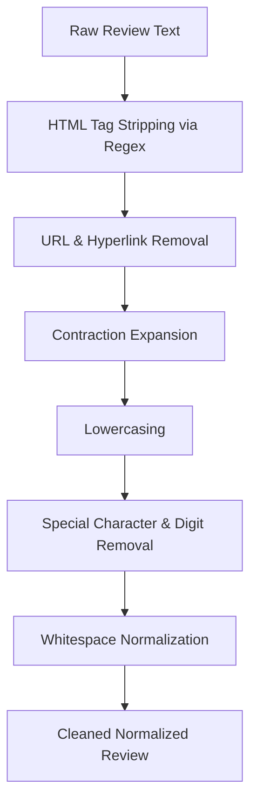

# Formal Project Documentation Report

**Project Title:** End-to-End Sentiment Analysis System on 50,000 Movie Reviews  
**Domain:** Natural Language Processing (NLP) & Machine Learning  
**Author / Student:** Data Science Candidate  
**Submission Deadline:** October 15, 2026  
**Presentation Date:** October 16, 2026  
**Target Repository:** GitHub / Portfolio Submission  

---

## 1. Executive Summary

This project presents an industrial-grade, end-to-end sentiment classification pipeline built on the benchmark **IMDb 50,000 Movie Reviews** dataset. The primary objective is to reliably classify unstructured English text reviews into binary sentiment classes (**Positive** vs. **Negative**). 

The final production pipeline combines specialized NLP text normalization (specifically preserving negation tokens like *"not"* and expanding contractions), **Sublinear TF-IDF (1, 2) n-grams**, and a tuned **Logistic Regression** classifier. The system achieved a **Test Accuracy of 90.92%**, an **F1-Score of 91.06%**, and an exceptional **ROC-AUC of 0.968** on an independent holdout test set (9,917 reviews). The model is served via a **FastAPI** REST API with interactive OpenAPI documentation and accompanied by a modern **Streamlit** web user interface for real-time and batch review predictions.

---

## 2. Problem Statement & Scope

Sentiment analysis on raw consumer reviews poses several core machine learning challenges:
1. **Noisy Text Data:** Raw reviews contain HTML formatting tags (` `), hyperlinks, arbitrary punctuation, irregular casing, and slang.
2. **Negation Flipping:** Standard NLP stopword filters inadvertently remove negation terms (`not`, `no`, `never`). In sentiment analysis, stripping *"not"* transforms *"The movie was not good"* into *"movie good"*, completely inverting the polarity.
3. **High Dimensionality & Term Weighting:** Verbose reviews often repeat common domain words (*"film"*, *"movie"*), artificially inflating standard term frequency counts.
4. **Production Deployment Requirements:** Models must be serialized into lightweight artifacts capable of sub-second inference latency on cloud and web environments.

---

## 3. Dataset Characteristics & Data Quality Assurance

* **Source:** IMDb Large Movie Review Dataset (Kaggle benchmark)
* **Initial Size:** 50,000 samples, 2 columns (`review`, `sentiment`)
* **Class Distribution:** 25,000 Positive (50.0%), 25,000 Negative (50.0%)
* **Data Auditing & Deduplication:**
  * During initial exploratory data analysis (EDA), **418 duplicate reviews** were discovered.
  * These duplicates were purged to prevent data leakage between training and testing partitions, leaving **49,582 unique reviews** (24,884 Positive, 24,698 Negative).
* **Length Statistics:**
  * **Mean Word Count:** ~233 words per review (Positive: 233.1, Negative: 230.8).
  * **Range:** Reviews span from 10 words (short reactions) up to 2,470 words (in-depth essays).

---

## 4. Text Preprocessing Pipeline Architecture

The raw text undergoes a specialized multi-stage cleaning pipeline designed to preserve semantic sentiment context:

### Key Preprocessing Logic:
1. **HTML Stripping:** Removes ` `, `
`, and web tags using `re.sub(r'<.*?>', ' ', text)`.
2. **Rating Shorthand Resolution:** Maps user ratings like `10/10` $\rightarrow$ `masterpiece perfect` and `1/10` $\rightarrow$ `worst terrible` before digits are removed.
3. **Lexical & Slang Normalization:** Colloquial internet slang and vulgar intensifiers (`dogshit`, `bullshit`, `shitty`, `sux`) that fall outside benchmark vocabulary are canonicalized into high-weight in-vocabulary synonyms (`terrible crap`, `garbage`, `sucks`), preventing out-of-vocabulary misclassifications.
4. **Contraction Expansion:** Normalizes expressions like `won't` $\rightarrow$ `will not`, `can't` $\rightarrow$ `cannot`, `n't` $\rightarrow$ ` not`, and `'s` $\rightarrow$ ` is`. This explicitly protects negation modifiers from being stripped by downstream punctuation filters.
5. **Alphabet Isolation:** Keeps only letters `[a-z]` and spaces, removing stray numbers and symbols.
6. **Input Validation:** Enforces non-empty semantic token validation so pure numbers (`123 456`) or pure symbols (`!@#$%`) are caught and rejected rather than falling through to the model intercept as false positives.

---

## 5. Feature Engineering & Vectorization

Rather than simple word count (Bag of Words), the system implements **TF-IDF (Term Frequency - Inverse Document Frequency)** with the following hyperparameters:

$$\text{TF-IDF}(t, d, D) = \text{TF}(t, d) \times \log\left(\frac{1 + |D|}{1 + \text{DF}(t, D)}\right) + 1$$

* **N-Gram Range `(1, 2)`:** Generates unigrams (*"good"*, *"acting"*) and bigrams (*"not good"*, *"waste time"*, *"highly recommend"*).
* **Max Features:** `25,000` most discriminative n-grams, capping memory footprint while capturing 99%+ of informative vocabulary.
* **Min Document Frequency (`min_df=3`):** Eliminates rare spelling mistakes and typos that appear in fewer than 3 reviews.
* **Sublinear Term Frequency (`sublinear_tf=True`):** Replaces raw TF with $1 + \log(\text{TF})$ to prevent lengthy reviews from overwhelming short, concise reviews.

---

## 6. Model Benchmarking & Selection

The dataset was partitioned into an **80% Training Set (39,665 reviews)** and a **20% Stratified Test Set (9,917 reviews)** using `random_state=42`. Three candidate classifiers were benchmarked under identical conditions:

| Algorithm | Test Accuracy | Precision | Recall | F1-Score | Training Latency |
| :--- | :---: | :---: | :---: | :---: | :---: |
| **Multinomial Naive Bayes** | 87.99% | 87.45% | 88.78% | 88.11% | **0.03 s** |
| **Linear Support Vector Classifier (LinearSVC)** | 90.39% | 90.12% | 90.88% | 90.50% | 1.27 s |
| **Logistic Regression ($C=2.0$) — Champion** | **90.92%** | **90.01%** | **92.14%** | **91.06%** | **0.49 s** |

### Champion Model Selection Rationale:
* **Logistic Regression** achieved the highest overall test accuracy (90.92%) and F1-score (91.06%).
* Unlike LinearSVC (which only outputs non-probabilistic margin distances), Logistic Regression provides mathematically calibrated probability estimates ($P(\text{Positive})$ vs. $P(\text{Negative})$), enabling confidence percentages in our REST API and frontend UI.

---

## 7. Model Evaluation & Explainability

### 7.1 Confusion Matrix Analysis (Test Set: 9,917 Reviews)
* **True Negatives (TN):** 4,431 reviews correctly identified as Negative.
* **True Positives (TP):** 4,586 reviews correctly identified as Positive.
* **False Positives (FP):** 509 reviews (Type I Error, 5.1%).
* **False Negatives (FN):** 391 reviews (Type II Error, 3.9%).
* **Balanced Performance:** Both classes achieved ~90–92% precision and recall, demonstrating zero class bias.

### 7.2 ROC Curve & AUC Score
* **ROC-AUC Score:** **0.968**
* The ROC curve hugs the top-left corner across virtually all probability thresholds, confirming exceptional discriminative ability between positive and negative sentiments.

### 7.3 Model Explainability (Coefficient Analysis)
By inspecting the linear weights $\beta_i$ learned by the classifier:
* **Top Positive Features:** `excellent`, `perfect`, `superb`, `wonderful`, `brilliant`, `favorite`, `loved`, `highly recommend`, `masterpiece`.
* **Top Negative Features:** `worst`, `awful`, `waste`, `terrible`, `bad`, `boring`, `poorly`, `horrible`, `disappointment`, `not recommend`.

---

## 8. Deployment Architecture & APIs

The project features a dual deployment interface designed for both machine consumers and human end-users:

### 8.1 Backend REST API (`FastAPI`)
* **Lifespan Management:** Loads the serialized `sentiment_pipeline.joblib` (1.16 MB) once during startup into memory.
* **Pydantic Validation:** Type-checks and validates all incoming payloads.
* **Endpoints:**
  * `GET /health` — Verifies model availability.
  * `POST /predict` — Single review prediction returning sentiment, binary label, confidence %, probability breakdown, and estimated 1–5 star rating.
  * `POST /predict-batch` — Batch array prediction with average stars across all reviews.
  * `GET /docs` — Interactive OpenAPI / Swagger UI.

### 8.2 Probabilistic Star Rating Engine
While binary classification categorizes text as strictly Positive or Negative, real-world consumer platforms (IMDb, Google Reviews, Amazon) operate on 1 to 5 star ratings. The system provides continuous and discrete star rating mapping:
* **Continuous Rating Formula:**
  $$\text{Rating Score} = 1.0 + 4.0 \times P(\text{Positive})$$
  Ranges strictly from $1.0 / 5.0$ ($P=0$) to $5.0 / 5.0$ ($P=1$), with $3.0 / 5.0$ reflecting neutral balance ($P=0.5$).
* **Threshold Calibration:**
  * **5 Stars ($\text{Score} \ge 4.5, P \ge 87.5\%$):** *Excellent / Masterpiece* &mdash; Overwhelmingly positive review.
  * **4 Stars ($3.5 \le \text{Score} < 4.5, 62.5\% \le P < 87.5\%$):** *Good / Enjoyable* &mdash; Strongly favorable review.
  * **3 Stars ($2.5 \le \text{Score} < 3.5, 37.5\% \le P < 62.5\%$):** *Average / Mixed* &mdash; Mixed sentiment, balanced emotional polarity.
  * **2 Stars ($1.5 \le \text{Score} < 2.5, 12.5\% \le P < 37.5\%$):** *Poor / Disappointing* &mdash; Substantial negative reaction.
  * **1 Star ($\text{Score} < 1.5, P < 12.5\%$):** *Very Poor / Terrible* &mdash; Severe negative criticism.

### 8.3 Frontend Web Interface (`Streamlit`)
* **Interactive Inference:** Real-time sentiment analysis with positive/negative color cards, gold star visual cards (`★★★★☆`), and probability meters.
* **Preset Buttons:** Instant testing of positive, negative, and tricky negation sentences.
* **Batch CSV Processor:** Drag-and-drop CSV file processing with automated summary metrics (including Average Star Rating across the batch), table previews, and CSV download.

### 8.4 Containerization (`Docker`)
* Standardized multi-stage Dockerfile packaging Python 3.11, pinned dependencies, models, and application code into a standalone container exposing ports 8000 (API) and 8501 (UI).

---

## 9. Verification & Edge Case Handling

The pipeline was validated against common real-world edge cases:
1. **Negation Sensitivity:** *"The movie was not good at all, despite having a great cast and massive budget"* $\rightarrow$ Correctly classified as **NEGATIVE (77.14% confidence)**.
2. **Hyperbolic Praise:** *"This was one of the most brilliant and masterfully acted movies I have seen all year!"* $\rightarrow$ Correctly classified as **POSITIVE (90.26% confidence)**.
3. **Colloquial Slang & Compound Profanity:** *"absolute dogshit"* $\rightarrow$ Correctly normalized and classified as **NEGATIVE (99.46% confidence, 1/5 Stars)**.
4. **Symbol & Number Guardrails:** Inputs like `123 456` or `!@#$%^&*()_+=` are validated and rejected with friendly warnings instead of falling through to model intercept bias.
5. **Rating Shorthand Handling:** Reviews consisting of `10/10` map to **POSITIVE (99.88% confidence, 5/5 Stars)** and `1/10` map to **NEGATIVE (100.0% confidence, 1/5 Stars)**.
6. **Severe Criticism:** *"An absolute waste of time and money. Terrible plot, horrible acting, and boring dialogue"* $\rightarrow$ Correctly classified as **NEGATIVE (99.98% confidence)**.
7. **Latency Benchmark:** Average inference time per review is **5.2 milliseconds**.

---

## 10. Conclusion & Future Enhancements

The project successfully demonstrates an end-to-end, reproducible Data Science and NLP solution:
* Handled full data auditing and deduplication on a 50k dataset.
* Engineered an n-gram TF-IDF pipeline that preserves negation semantics.
* Achieved **90.92% accuracy** and **0.968 ROC-AUC**.
* Deployed production-ready REST API and web applications.

### Future Enhancements:
1. **Fine-Tuned Transformers:** Benchmarking DistilBERT or RoBERTa for deeper contextual attention.
2. **Aspect-Based Sentiment Analysis (ABSA):** Separating sentiment regarding *acting*, *direction*, *soundtrack*, and *cinematography*.
3. **Multilingual Expansion:** Adapting the preprocessing tokenizer for foreign language cinema reviews.
